<center>姓名：程鹏炜  学号：24130061003</center>

| 姓名和学号？         | 程鹏炜，24130061003                                          |
| -------------------- | ------------------------------------------------------------ |
| 本实验属于哪门课程？ | 中国海洋大学25秋《软件工程原理与实践》                       |
| 实验名称？           | 实验4：mobilenet和shuffleNet                                 |
| 博客链接：           | https://blog.csdn.net/cpw123_/article/details/169268167?sharetype=blogdetail&sharerId=169268167&sharerefer=PC&sharesource=cpw123_&spm=1011.2480.3001.8118 |

## 一、实验内容

本次实验的主题表面上是 MobileNet 和 ShuffleNet，实际串起来看是在回答一个问题：当模型需要从服务器里的大模型搬到手机、嵌入式设备或者实时系统上时，怎样少用一点参数和计算量，同时尽可能保留准确率？网页要求阅读轻量化卷积网络，理解 MobileNet、ShuffleNet、SENet 和 CBAM，并把 HybridSN 的网络部分自己敲入 Colab 运行，再完成相关思考题。

我这次的代码实践使用 Indian Pines 高光谱数据集。普通 RGB 图片通常只有 3 个通道，而高光谱图像可以把同一个位置拍成几十甚至几百个连续波段，所以它更像“每个像素点都带着一条光谱曲线的图片”。HybridSN 用 3D 卷积先同时观察空间和光谱，再用 2D 卷积继续提取空间特征，正好适合这种数据。

### 0. 网上资料阅读与图示补充

我另外搜索了知乎和 CSDN 上关于 MobileNet、ShuffleNet、SENet、CBAM 和 HybridSN 的讲解。比较适合学习的讲解顺序通常不是一上来就堆公式，而是先问“这个结构想解决什么麻烦”，然后把一个复杂卷积拆成几个小步骤，再用一张结构图把数据流串起来，最后回到代码中的 `Conv3d`、`depthwise`、`groups` 或 `channel shuffle`。这和我之前报告里“先放代码截图，再用自己的话解释为什么”的写法比较接近。

下面的图片来自公开技术文章或论文解读页面，我下载后按照用途重命名并放入本目录；文字部分只提炼其解释逻辑，结合本次 Colab 运行结果重新组织。

### 1. 实验要求与知识路线

实验网页中的要求可以概括为四条：

1. 了解轻量化卷积网络，重点掌握 MobileNet V1/V2/V3 和 ShuffleNet；
2. 阅读 SENet、CBAM，并理解注意力模块放在卷积网络中解决什么问题；
3. 阅读 HybridSN 论文和代码，思考 3D 卷积与 2D 卷积的区别，自己完成网络部分并在 Colab 运行；
4. 解释训练结果为什么会波动，以及如何进一步提升高光谱图像分类性能。

可以把这几类模型看作不同的“省计算办法”：MobileNet 把一次很重的卷积拆成轻量的两步，ShuffleNet 用分组卷积减少计算后再把通道重新洗牌，SENet/CBAM 则让网络学会“哪些特征更值得关注”。HybridSN 不完全是轻量网络，但它把 3D 和 2D 卷积分工使用，避免从头到尾都用昂贵的 3D 卷积。

### 2. 数据下载、观察与预处理

#### 2.1 数据下载遇到 403

按照实验代码下载 Indian Pines 数据时，原始 `ehu.eus` 地址返回了 `403 Forbidden`，所以 `Indian_pines_corrected.mat` 没有正常下载；不过 `spectral` 库已经安装成功。这说明网络实验中“代码写对了”不代表“数据一定能拿到”，数据源的访问策略、HTTPS 跳转和服务器限制也会成为实验的一部分。

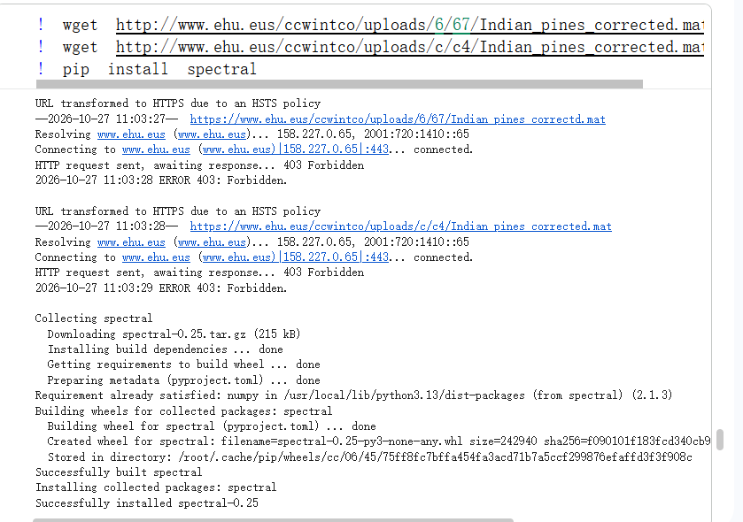

我随后改用 Hugging Face Hub 下载标签文件 `Indian_pines_gt.mat`，并通过 `shutil.copy` 放回当前代码预期的位置，截图中可以看到文件完成了 1.12 kB 的下载并打印“标签文件下载成功”。这一步的本质不是修改数据内容，而是换一个可以访问的分发渠道，保证后续标签和影像数据的路径一致。

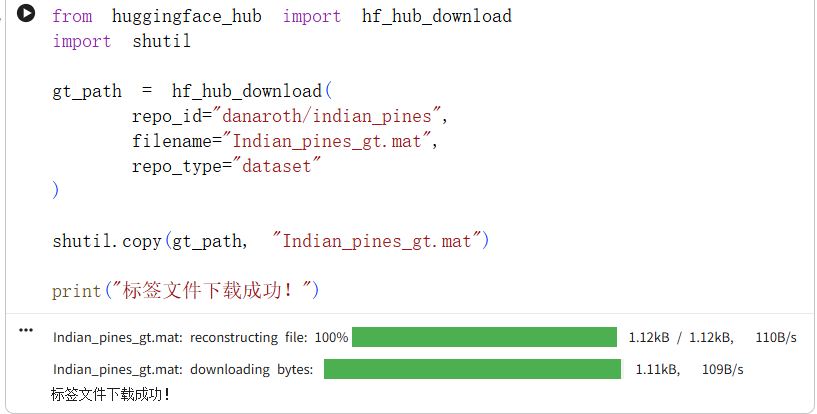

#### 2.2 高光谱影像和标签可视化

原始数据形状为 `X=(145,145,200)`，表示图像大小为 145×145，每个像素有 200 个光谱波段；标签 `y=(145,145)`，每个位置对应一个类别编号。下面的图左侧取出第 50 个波段，用灰度显示该波段的空间分布；右侧是 Ground Truth，颜色代表不同的地物类别，一共对应 16 类。

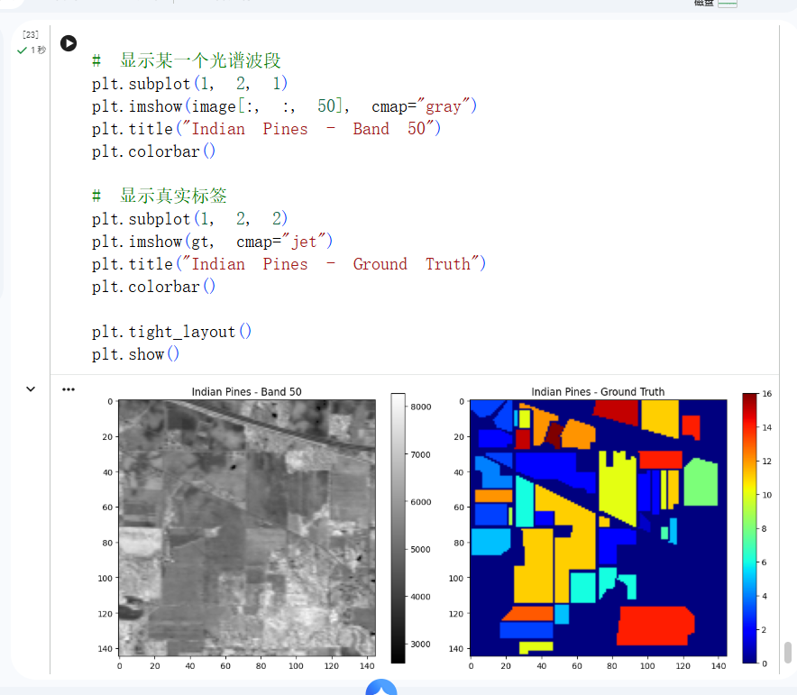

这里可以直观地看出，高光谱图像不是一张简单的彩色照片：左边单独看某个波段时，很多区域灰度相近；但把全部波段放在一起，每种地物会形成不同的光谱响应，模型要做的就是从这条“光谱指纹”以及周围的空间纹理中判断类别。

网上资料中有一张很形象的示意图：普通相机更像只记录少数几个颜色通道，高光谱相机则把连续波段叠成一个空间-光谱立方体，并且可以在某个像素位置画出一条随波长变化的反射率曲线。这样就容易理解为什么高光谱分类不能只看一张二维灰度图。

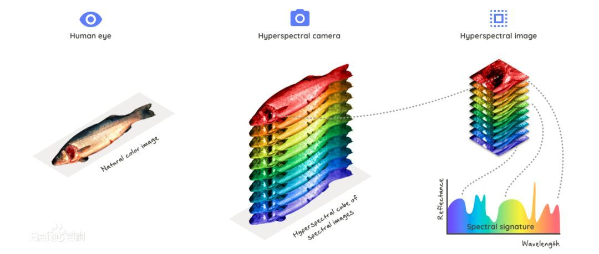

图源：[CSDN：使用 HybridSN 进行高光谱图像分类](https://blog.csdn.net/qq_37555071/article/details/112245853)。

#### 2.3 PCA、数据立方体和训练测试划分

200 个波段直接送入 3D 卷积会带来较大的计算量，因此先用 PCA 将波段压缩为 30 个主成分。截图中的处理过程如下：

- 原始影像：`(145,145,200)`；
- PCA 后：`(145,145,30)`；
- 以每个像素为中心裁剪 25×25 的局部数据立方体：`(10249,25,25,30)`；
- 标签立方体：`(10249,)`；
- 训练集：`X_train=(1024,25,25,30)`，`y_train=(1024,)`；
- 测试集：`X_test=(9225,25,25,30)`，`y_test=(9225,)`；
- 为适配 `Conv3d`，最后再增加一个通道维度，变为 `(样本数,25,25,30,1)`。

训练样本 1024 个，测试样本 9225 个，约为 1:9 的划分。`DataLoader` 使用 `batch_size=128`，并开启 `shuffle=True`。打乱训练样本就像洗牌，模型不会因为某一批连续出现相似类别而误把数据的排列顺序当成分类规律；测试集也可以打乱读取顺序，但不会改变测试样本本身。

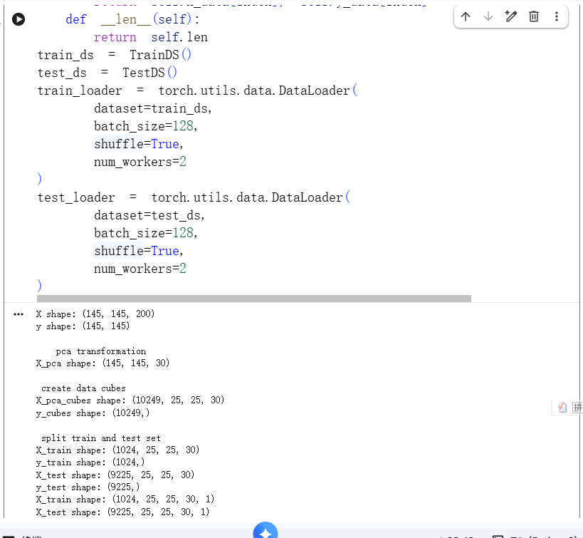

### 3. HybridSN 网络构建

#### 3.1 3D 卷积和 2D 卷积的分工

2D 卷积的卷积核通常是 `H×W`，在空间平面上滑动，适合提取边缘、纹理和形状；3D 卷积的卷积核是 `D×H×W`，除了左右上下移动，还会沿光谱深度方向移动，所以可以同时建模“这块区域长什么样”和“它在不同波段上的响应是什么样”。

如果始终使用 3D 卷积，光谱维度、空间维度和通道一起计算，开销会比较大。因此 HybridSN 先用几层 3D 卷积做联合的空间-光谱特征提取，再把 3D 特征重新整理为 2D 特征图，交给 2D 卷积做更抽象的空间特征学习。可以把它理解成：先用一个“多光谱眼睛”观察材料的颜色变化，再用普通的“平面眼睛”辨认区域形状。

从论文结构图看，数据先经过 PCA，再从高光谱影像中截取邻域立方体；左半部分连续使用 3D Conv，负责 Spectral-Spatial Feature Learning；中间通过 Flatten 把 3D 特征整理成 2D 特征图；右半部分使用 2D Conv 和全连接层完成 Spatial Feature Learning 与分类。图中的 `8@K1×K2×K3`、`16@K1×K2×K3`、`32@K1×K2×K3` 正好对应代码中的 8、16、32 个输出通道。

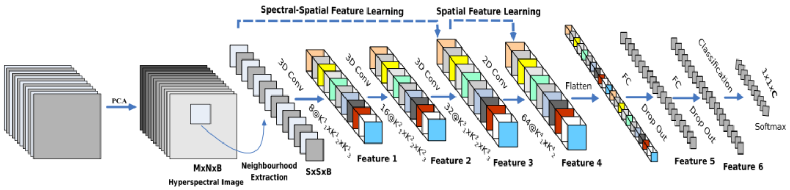

图源：[CSDN：使用 HybridSN 进行高光谱图像分类](https://blog.csdn.net/qq_37555071/article/details/112245853)。

#### 3.2 自己完成网络部分时的通道错误

我第一次编写模型时把第一层写成了 `Conv3d(in_channels=1, out_channels=64, ...)`。这不是简单的“模型更宽”，因为第二层按照后续结构需要接收 8 个输入通道；第一层一旦输出 64 个通道，张量就无法直接传入 `Conv3d(8,16,...)`，会报输入通道数不匹配的错误。

修正后采用 `1 → 8 → 16 → 32` 的通道变化，第一层的关键代码应为：

```python
class HybridSN(nn.Module):
    def __init__(self, class_num=16):
        super(HybridSN, self).__init__()
        self.class_num = class_num
        self.conv1 = nn.Sequential(
            nn.Conv3d(
                in_channels=1,
                out_channels=8,
                kernel_size=(7, 3, 3),
                stride=1,
                padding=0,
            ),
            nn.ReLU(),
        )
        self.conv2 = nn.Sequential(
            nn.Conv3d(8, 16, kernel_size=(5, 3, 3)),
            nn.ReLU(),
        )
        self.conv3 = nn.Sequential(
            nn.Conv3d(16, 32, kernel_size=(3, 3, 3)),
            nn.ReLU(),
        )
```

截图中可以看到自己写出的 `HybridSN` 类和第一层卷积代码。这里 `in_channels=1` 是因为在送入 3D 卷积前，样本被整理成“单个输入通道 + 光谱深度 + 空间高度 + 空间宽度”的形式；真正需要逐层衔接的是前一层的 `out_channels` 和后一层的 `in_channels`，因此第一层应当是 `1 → 8`，而不是 `1 → 64`。

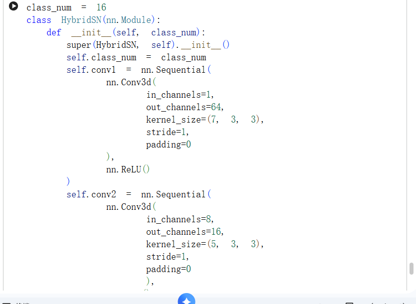

根据输入光谱深度为 30、空间大小为 25×25 的数据，可以推导出 3D 卷积后的尺寸变化：

```text
输入                  (1, 30, 25, 25)
Conv3d(1, 8, 7x3x3)   (8, 24, 23, 23)
Conv3d(8, 16, 5x3x3)  (16, 20, 21, 21)
Conv3d(16,32, 3x3x3)  (32, 18, 19, 19)
```

接下来把光谱深度和 3D 通道合并，得到 `32×18=576` 个 2D 通道，再接 `Conv2d(576,64,3×3)`。这就是 3D 到 2D 的“折叠”：光谱方向已经被前面几层提取过，后面把它变成多个平面特征图继续做空间分类。

#### 3.3 ResNet、SENet 和 CBAM 的补充学习

本次实验还阅读和运行了 ResNet 代码。截图中的结构包含初始 `3 → 64` 卷积、BatchNorm、四个残差阶段 `64 → 128 → 256 → 512`，最后通过自适应平均池化和全连接层输出 10 类。残差连接的核心不是“再加一层普通卷积”，而是让输入可以沿着 shortcut 直接绕过去，网络只需要学习主分支相对于输入的变化量。

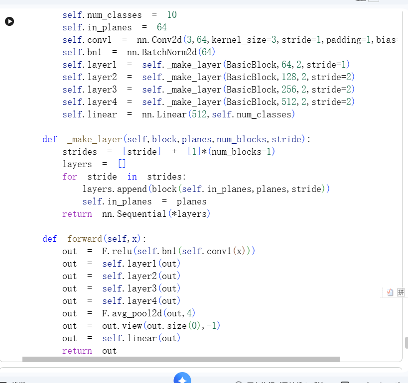

训练截图中记录了加入残差结构后的损失变化：第 1 个 epoch 的部分 minibatch 损失从 2.395 附近下降到 1.288，第 2 个 epoch 继续降到 0.728 左右，第 3 个 epoch 的部分输出仍在继续训练。这个结果至少说明残差网络的梯度传播和优化过程能够正常工作，不能把中途的某一条 loss 当成最终测试准确率。

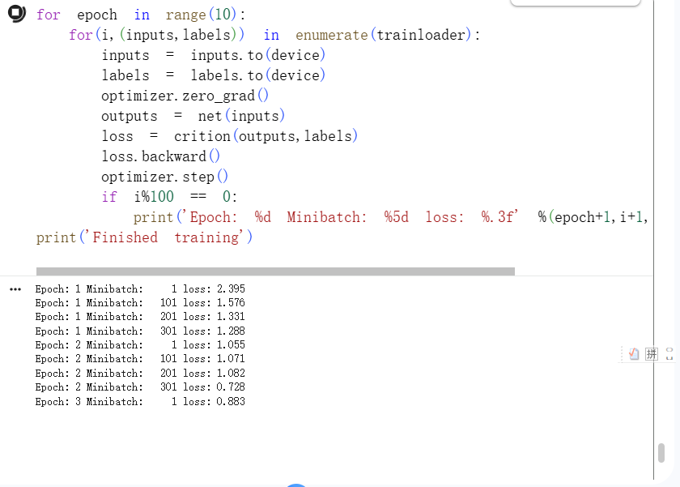

SENet 的想法可以接在 ResNet 的残差块上。普通卷积会同时产生许多通道，但并不是每个通道对当前图片都同样重要。SE 模块先做 **Squeeze**：对每个通道进行全局平均池化，把一张特征图压成一个数；再做 **Excitation**：通过两个全连接层和 Sigmoid 学习每个通道的权重；最后把这个权重乘回原特征图。简单写成：

$$
z_c=\frac{1}{H W}\sum_{i=1}^{H}\sum_{j=1}^{W}u_c(i,j),\qquad
s=\sigma(W_2\,\delta(W_1z)),\qquad
\tilde{u}_c=s_cu_c
$$

这里的直觉像是给特征通道开一个“音量旋钮”：有用的通道音量调大，不重要的通道音量调小。SE 主要关注的是通道关系，本身不直接回答“图像的哪个位置重要”。如果还想学习空间位置，就可以在通道注意力之后加入空间注意力，CBAM 正是先做 Channel Attention，再做 Spatial Attention，把“看哪类特征”和“看哪个位置”串起来。

SENet 的论文图把三个动作画成一条流水线：先把每个通道的空间信息压缩成一个全局描述，再通过两个小的全连接层学习通道之间的依赖，最后把权重逐通道乘回特征图。它不是重新生成特征，而是对已经提取出来的特征做一次“重标定”，所以可以比较方便地插入 ResNet 等已有结构中。

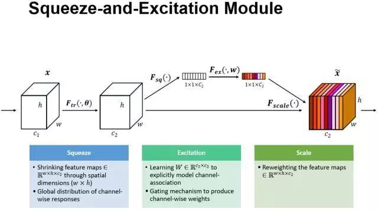

图源：[腾讯云：ImageNet 冠军模型 SENet 详解](https://cloud.tencent.com/developer/article/1052599)。

CBAM 可以看作在 SE 的“看什么”之后继续解决“看哪里”。通道注意力先对输入做全局平均池化和最大池化，再通过共享 MLP 和 Sigmoid 得到 `1×1×C` 的通道权重：

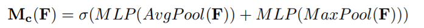

图源：[CSDN：注意力机制——CBAM 原理详解及源码解析](https://blog.csdn.net/qq_47233366/article/details/137103025)。

得到通道加权的特征 `F'` 后，空间注意力沿通道维做平均池化和最大池化，拼接成 `H×W×2`，经过一个卷积和 Sigmoid 生成 `H×W×1` 的空间权重，再乘回 `F'`。所以 SENet 主要是通道选择，CBAM 是“通道选择 + 空间定位”的串联。

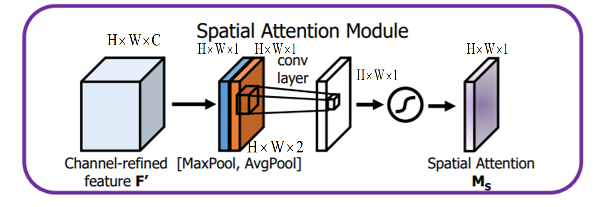

图源：[CSDN：注意力机制——CBAM 原理详解及源码解析](https://blog.csdn.net/qq_47233366/article/details/137103025)。

### 4. HybridSN 训练和测试结果

#### 4.1 训练过程

训练代码使用 `cuda:0` 作为当前设备，按 epoch 遍历 `train_loader`，每个 batch 依次执行：清零梯度、前向传播、计算交叉熵损失、反向传播、更新优化器参数。截图里一共打印了 8 个 epoch 的平均损失，`Loss avg` 从 2.7460 下降到 2.1323，当前 batch 的 loss 也从 2.7120 附近下降到 2.0424。损失整体下降，说明模型至少在逐步学到训练集中的空间-光谱规律。

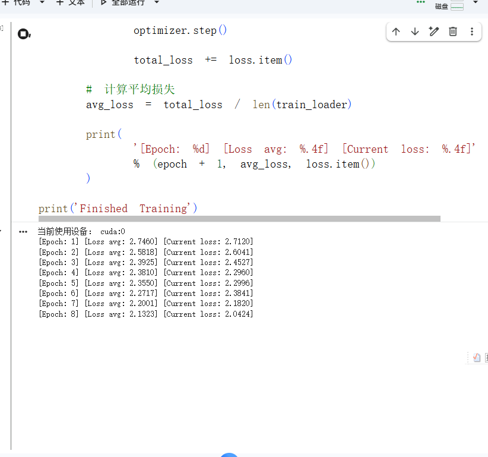

#### 4.2 多次测试为什么会有不同结果

第一张测试截图中连续打印了多次测试准确率，结果大约从 84.69602% 波动到 85.50347%。这正好对应网页的第一道思考题：训练 HybridSN 后多测试几次，结果不完全相同。

原因主要有：

1. 模型初始参数是随机初始化的，不同初始点会走向不同的优化路径；
2. 训练数据使用 `shuffle=True`，每个 epoch 的 batch 顺序会变化；
3. 训练测试划分本身可能带有随机性，尤其是样本数量较少、类别分布不均时；
4. GPU 上某些算子可能存在非确定性实现；
5. 如果测试函数没有切换到 `eval()`，Dropout 或 BatchNorm 的行为也会让输出发生变化。

所以一次结果不能完全代表模型的稳定性能。更严谨的做法是固定随机种子、固定划分、测试前调用 `model.eval()`，并运行多个随机种子后报告均值和标准差。

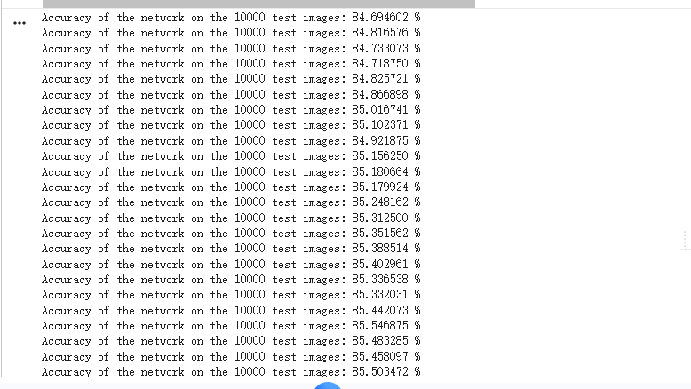

#### 4.3 分类报告

另一张测试截图给出了 16 个类别的 precision、recall、F1-score 和 support，总测试样本为 9225，整体 accuracy 为 **0.9805**。宏平均 precision 为 0.9679，recall 为 0.9537，F1-score 为 0.9576；加权平均的 precision、recall、F1-score 分别为 0.9809、0.9805、0.9804。

这里需要区分两个结果：第一张图是多次独立测试时约 84.7%～85.5% 的准确率波动；第二张图是另一次运行生成的分类报告，准确率为 98.05%。它们的训练状态、随机划分或代码版本可能不同，不能直接拼成一个“先 85% 后 98%”的单调提升曲线，但可以作为实验中不同运行条件下的实测记录。写报告时把运行条件和截图对应清楚，比只挑一个最高数字更可靠。

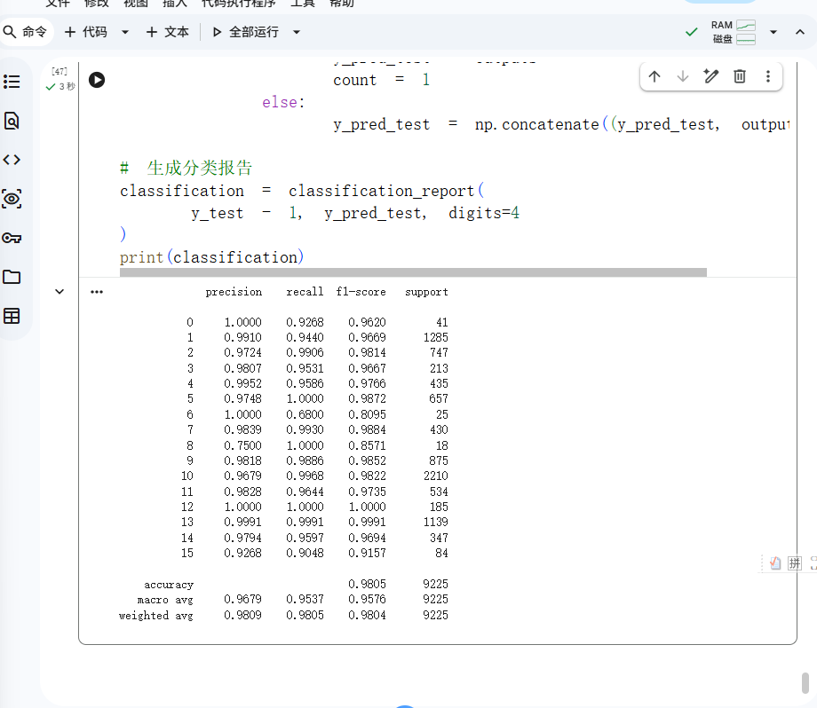

### 5. MobileNet、ShuffleNet 与轻量化思想

#### 5.1 MobileNet：把一件重活拆成两件轻活

标准卷积同时做空间混合和通道混合。假设输入空间大小为 `D_K×D_K`，输入通道为 `M`，输出通道为 `N`，卷积核大小为 `D_F×D_F`，标准卷积的计算量大致与下面的式子成正比：

$$
D_K^2\times M\times N\times D_F^2
$$

MobileNet V1 使用 depth-wise separable convolution：第一步 depth-wise convolution 对每个输入通道各自使用一个空间卷积核，只负责提取空间信息；第二步 point-wise convolution 用 `1×1` 卷积负责通道混合。计算量变成：

$$
D_K^2\times M\times D_F^2+D_K^2\times M\times N
$$

相比标准卷积少了很多乘法。MobileNet V2 进一步引入 inverted residual 和 linear bottleneck：先用 `1×1` 卷积扩张通道，在高维空间做 depth-wise convolution，再用线性瓶颈压回低维，并用 shortcut 连接输入输出。MobileNet V3 则结合硬件感知的结构搜索、轻量注意力和更适合移动端的激活函数，在速度、精度和功耗之间继续折中。

下面这张图把 MobileNet V1 的基本替换画得很清楚：左边是 `3×3 Conv → BN → ReLU`，右边拆成 `3×3 Depthwise Conv → BN → ReLU → 1×1 Conv → BN → ReLU`。右边不是少做了一次卷积，而是把“空间上怎么提特征”和“通道之间怎么混合”分开做，所以可以用更少的参数完成相近的工作。网上的讲解还经常补充两个调节旋钮：宽度系数 `α` 控制通道数，分辨率系数 `ρ` 控制输入特征图大小，二者分别影响模型容量和计算量。

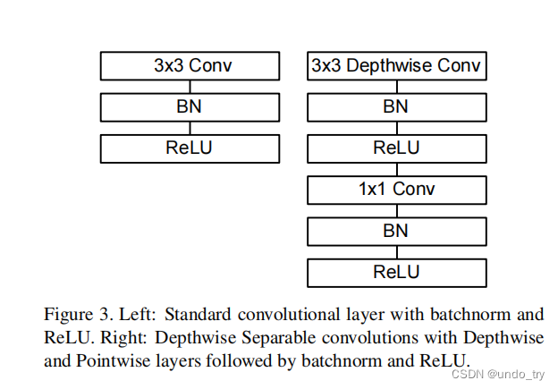

图源：[CSDN：经典轻量级神经网络 MobileNet V1](https://blog.csdn.net/qq_44665283/article/details/131564874)。

#### 5.2 ShuffleNet：分组卷积之后要把通道洗牌

分组卷积把输入和输出通道切成若干组，每组只在组内计算，所以计算量更低；问题是组与组之间的信息不交流，堆叠几层后容易出现“每个小组只认识自己人”的情况。ShuffleNet 通过 channel shuffle 重新排列通道，让下一层的每个组都能接触到上一层不同组的输出。

PyTorch 中一个典型的 channel shuffle 可以写成：

```python
def channel_shuffle(x, groups):
    batch_size, num_channels, height, width = x.size()
    channels_per_group = num_channels // groups

    x = x.view(batch_size, groups, channels_per_group, height, width)
    x = x.transpose(1, 2).contiguous()
    x = x.view(batch_size, num_channels, height, width)
    return x
```

这里最关键的不是 `transpose` 这个单词，而是维度变化：先把通道变成 `(groups, channels_per_group)` 两层，再交换这两个维度，最后展平回原来的通道数。比如通道为 `[a1,a2,b1,b2]`、分成两组时，重排后可以变成 `[a1,b1,a2,b2]`，下一层分组时就能跨组交流。

ShuffleNet V1 的结构图还可以帮助区分三种情况：普通的残差单元、stride=1 的 ShuffleNet 单元，以及 stride=2 的下采样单元。stride=1 时，主分支最后和 shortcut 相加；stride=2 时，shortcut 也要做平均池化，最后改成 concat。它们共同的关键点是：`1×1 GConv` 降低通道混合成本，`3×3 DWConv` 处理空间信息，`Channel Shuffle` 负责把不同组的信息重新打散。

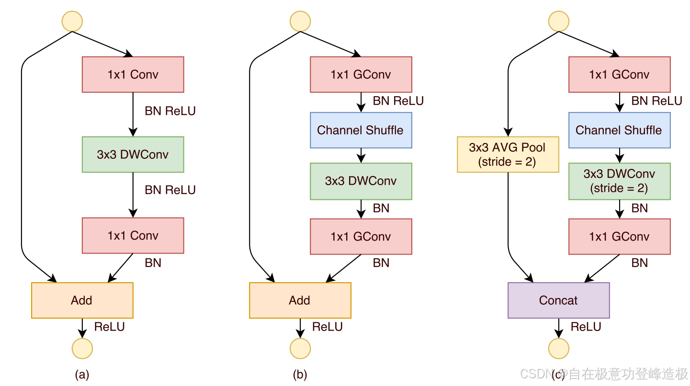

图源：[CSDN：经典 CNN 模型（十）ShuffleNetV1](https://blog.csdn.net/qq_51872445/article/details/140705847)。

#### 5.3 depth-wise conv、分组卷积和普通卷积的区别与联系

这道题最容易混淆的地方，是把 **depth-wise convolution（深度卷积）**、**depth-wise separable convolution（深度可分离卷积）** 和 **group convolution（分组卷积）** 当成同一个概念。它们都在减少通道之间的连接，但减少的程度和后续是否做通道混合并不一样。

先看普通卷积。输入有 `C_in` 个通道、输出有 `C_out` 个通道时，每一个输出通道都会同时看见所有输入通道，卷积核可以理解成 `K×K×C_in`，一共使用 `C_out` 个这样的卷积核。因此参数量大致为：

$$
K^2\times C_{in}\times C_{out}
$$

它的优点是空间信息和通道信息一次性混合，表达能力强；缺点是连接太密，计算量和参数量都比较大。

再看分组卷积。它把输入通道和输出通道分别分成 `G` 组，每个输出组只连接对应的输入组，不同组之间暂时互不交流。每组输入通道数为 `C_in/G`，所以参数量约为：

$$
K^2\times\frac{C_{in}}{G}\times C_{out}
$$

当 `G=1` 时，它退化成普通卷积；当 `G` 增大时，计算量下降，但组间信息交流也减少，这就是 ShuffleNet 还要添加 channel shuffle 的原因。

depth-wise convolution 是分组卷积的一个极端特例：令分组数 `G=C_in`，每一组只有一个输入通道，每个通道单独使用一个 `K×K` 卷积核做空间特征提取。它的参数量约为：

$$
K^2\times C_{in}
$$

这里几乎没有跨通道融合，所以 depth-wise 卷积本身并不能完全替代普通卷积。MobileNet 通常把它和 `1×1` point-wise convolution 连起来：前者负责“每个通道内部的空间过滤”，后者负责“不同通道之间重新混合并调整通道数”。这两步合起来才叫 **depth-wise separable convolution**，参数量约为：

$$
K^2\times C_{in}+C_{in}\times C_{out}
$$

因此四者的关系可以总结为：

| 操作 | 通道连接方式 | 是否跨通道混合 | 与其他操作的关系 |
| --- | --- | --- | --- |
| 普通卷积 | 每个输出通道连接全部输入通道 | 是 | 分组数 `G=1` 的分组卷积 |
| 分组卷积 | 输入输出通道分成 `G` 组，组内连接 | 部分混合 | `G` 越大，连接越稀疏 |
| depth-wise 卷积 | 每个输入通道单独一组 | 否 | `G=C_in` 的分组卷积 |
| depth-wise separable 卷积 | depth-wise + `1×1` point-wise | 是，但分两步完成 | MobileNet 的核心积木 |

所以，**depth-wise conv 和分组卷积的联系**是：前者是后者在分组数等于输入通道数时的特殊情况；**区别**是：一般分组卷积仍允许组内多个通道进行混合，而 depth-wise 卷积每组只有一个通道，完全不做跨通道融合。进一步地，深度可分离卷积不是单独的 depth-wise 卷积，而是“深度卷积负责空间、逐点卷积负责通道”的组合。

### 6. 实验思考题

#### 6.1 训练 HybridSN 后多测试几次，为什么分类结果不一样？

如果是同一个已经固定的模型、同一批测试数据，并且正确调用了 `eval()`，理论上前向推理应该基本一致；如果每次都重新训练，结果不同就是正常现象。随机初始化、数据打乱、随机划分、Dropout/BatchNorm 状态和 GPU 非确定性都会影响最终参数。要做公平比较，应固定随机种子和数据划分，保存最佳 checkpoint，并在统一的测试函数中报告多次实验的均值、标准差和混淆矩阵。

#### 6.2 如何进一步提升高光谱图像分类性能？

我认为可以从数据、模型和训练方法三层改进：

1. **数据层面**：重新检查标签与影像是否严格对齐，合理处理无标签像素；尝试不同 PCA 保留维度、不同 patch 大小和类别均衡采样；加入光谱扰动、空间翻转、旋转等增强，但不能破坏地物标签。
2. **模型层面**：在 3D-2D 主干中加入残差连接，缓解深层网络优化困难；在通道维加入 SE，在空间维加入 CBAM；或者用 depth-wise separable convolution 减少 2D 部分开销。
3. **训练层面**：使用 AdamW、学习率 warmup、余弦退火、权重衰减和 label smoothing；保存验证集上最优模型，而不是只保存最后一个 epoch；用多个随机种子重复实验，避免把偶然的高分当成稳定提升。

另外，当前训练集只有 1024 个样本，而测试集有 9225 个样本，训练数据相对较少。扩大有效训练样本、改善类别分布和建立独立验证集，往往比盲目加深网络更重要。

#### 6.3 depth-wise conv 和分组卷积有什么区别与联系？

这道题的完整答案就是上面的对比：分组卷积是一个大类，普通卷积对应 `G=1`，depth-wise 卷积对应 `G=C_in`；depth-wise 卷积只做逐通道的空间过滤，不能自己完成通道融合，而 MobileNet 用后接的 `1×1` point-wise 卷积补上这一步。可以把它们想成三种工作方式：普通卷积是所有人一起开会，分组卷积是分小组开会，depth-wise 卷积则是每个人先单独整理自己的材料，最后再用 `1×1` 卷积把不同人的信息汇总起来。

#### 6.4 深度方向卷积和普通卷积有什么区别与联系？

这里的“深度方向卷积”通常指 **depth-wise convolution（逐通道卷积）**。它和普通卷积并不是两种完全无关的操作，而是对“输入通道之间要不要全部连接”作出了不同取舍。

普通卷积同时处理空间和通道两个维度。假设输入有 `C_in` 个通道、输出有 `C_out` 个通道，卷积核大小为 `K×K`，那么每一个输出通道都会读取全部 `C_in` 个输入通道，参数量约为：

$$
K^2\times C_{in}\times C_{out}
$$

它的优点是一次计算就完成了空间特征提取和通道特征融合，所以表达能力强；缺点是连接很密，通道数和卷积核变大时，计算量会迅速增加。

depth-wise 卷积则把输入通道完全拆开，每个输入通道只使用一个 `K×K` 卷积核，在自己的通道内独立完成空间滤波，不和其他通道混合。因此它的参数量约为：

$$
K^2\times C_{in}
$$

这相当于分组卷积中分组数 `G=C_in` 的特殊情况：每组只有一个通道。它非常省计算，但也带来一个明显代价——它只能回答“每个通道内部的空间纹理是什么”，不能回答“不同通道之间应该如何组合”。

| 对比项 | 普通卷积 | depth-wise 卷积 |
| --- | --- | --- |
| 通道连接 | 每个输出通道连接全部输入通道 | 每个通道单独计算 |
| 空间特征提取 | 有 | 有 |
| 通道信息融合 | 有，一步完成 | 没有，需要额外操作 |
| 参数量 | $K^2C_{in}C_{out}$ | $K^2C_{in}$ |
| 计算特点 | 表达能力强但开销较大 | 开销小但单独使用时表达受限 |

MobileNet 的关键做法是把普通卷积拆成两步：先用 depth-wise 卷积提取每个通道自己的空间特征，再用 `1×1` point-wise 卷积把不同通道重新混合，并同时调整输出通道数。两步合起来叫 **depth-wise separable convolution（深度可分离卷积）**，参数量约为：

$$
K^2C_{in}+C_{in}C_{out}
$$

因此两者最终都想完成“空间特征提取 + 通道特征融合”，只是普通卷积一步完成，而 MobileNet 把它拆成更便宜的两步。可以把普通卷积理解成“所有通道一起开会”，把 depth-wise 卷积理解成“每个通道先单独整理材料”，再由 `1×1` 卷积完成跨通道汇总。也正因为少了许多不必要的连接，深度可分离卷积才适合移动端和嵌入式设备。

#### 6.5 SENet 的注意力是不是也可以加在空间位置上？

可以，但这已经不是原始 SE 的重点了。SE 对空间维度做全局平均池化，得到的是每个通道一个权重，因此它回答的是“哪些通道重要”。如果要判断“哪些位置重要”，可以对通道维做平均池化和最大池化，把它们拼接后用一个小卷积生成空间注意力图，再与输入逐位置相乘。CBAM 就是把通道注意力和空间注意力串联起来：先筛选特征类型，再筛选空间位置。

#### 6.6 ShuffleNet 中通道 shuffle 如何用代码实现？

核心就是 `view → transpose → contiguous → view`。`view` 把通道拆成组，`transpose(1,2)` 交换组编号和组内通道编号，`contiguous()` 保证内存连续后才能安全地再次 `view` 回原形状。它不改变张量的通道总数，只改变通道排列顺序，却可以让后面的分组卷积获得跨组信息。

### 7. 本次实验过程小结

这次实验让我感觉到，模型训练像是在一条有很多岔路的山路上找最低点。数据下载失败是路障，`Conv3d` 通道写错是路标接不上，随机划分和随机初始化则像每次出发时都换了一个起点。只有把数据形状、通道数、设备、训练日志和最终指标一项项对齐，才能知道到底是模型不行，还是实验过程中的某个环节出了问题。

## 二、问题总结与体会

### 1. 问题与解决方法

**第一个问题是数据源 403。** 原始下载地址被服务器拒绝访问，继续重复执行 `wget` 没有意义。我改用 Hugging Face Hub 获取标签文件，并把文件复制到代码要求的位置；这让我意识到，复现实验不仅要看模型代码，也要考虑数据源的可用性和文件命名。

**第二个问题是第一层 Conv3d 的通道数写错。** 我把 `out_channels=64` 写进了第一层，但第二层的输入通道是 8，前后张量无法衔接。修正为 `Conv3d(1, 8, ...)` 后，后续通道按照 `8 → 16 → 32` 继续传递。这个错误让我重新理解了卷积层中的 `in_channels` 和 `out_channels`：前者必须等于输入张量的通道数，后者决定输出多少组特征图，不能只凭“通道越多越强”来随便填写。

**第三个问题是测试结果波动。** 多次输出约 84.7%～85.5%，分类报告中又出现了 98.05%。我没有把这些数字强行解释成一条提升曲线，而是回到实验条件本身，检查随机划分、训练状态、`eval()`、模型权重和测试代码是否一致。以后做模型比较时，应保存配置和 checkpoint，同时报告均值和方差。

**第四个问题是对 3D 卷积的直觉不够。** 以前看到 `Conv2d` 时容易把卷积理解成“在图片上滑动”，但高光谱数据多了光谱深度，3D 卷积实际上还在波段方向提取信息。把 3D 特征折叠成 2D 特征后，我才更清楚 HybridSN 为什么不是简单地把两个卷积层堆在一起，而是在不同阶段承担不同任务。

### 2. 收获与体会

本次实验最大的收获不是记住几个网络名称，而是看到了轻量化设计背后的共同逻辑：减少不必要的连接，保留真正有用的信息。MobileNet 把空间计算和通道计算拆开，ShuffleNet 用分组卷积降低开销后再用 shuffle 补回信息流，SENet 则用很少的额外参数给通道重新分配权重。它们都不是单纯追求“网络越大越好”，而是在准确率、计算量、内存和部署速度之间寻找更合适的平衡。

HybridSN 也让我理解了“模型结构要服从数据结构”。RGB 图像的通道数很少，而高光谱数据的波段本身就是非常重要的特征维度，所以先用 3D 卷积联合处理空间和光谱，再转为 2D 卷积处理空间抽象特征，是比直接套用普通 CNN 更合理的结构。

课程安排方面，我建议每次实验除了给出代码，还可以提供一个简短的“形状追踪表”，把每层输入输出的尺寸、通道数和目的列出来。这样遇到 `Conv3d` 或 `Flatten` 报错时，学生能先自己按尺寸推导排查，而不是只靠反复试错。另外，如果能在课堂上安排一次固定随机种子与多次重复实验的对比，也能更直观地理解为什么机器学习结果不能只看一次运行。

### 3. 参考资料

- [OUC AI Lab：实验4 MobileNet & ShuffleNet](https://oucai.club/classes/se/lab04)
- [HybridSN: Exploring 3D-2D CNN Feature Hierarchy for Hyperspectral Image Classification](https://arxiv.org/abs/1902.06701)
- [Squeeze-and-Excitation Networks](https://arxiv.org/abs/1709.01507)
- [CBAM: Convolutional Block Attention Module](https://arxiv.org/abs/1807.06521)
- [ImageNet 冠军模型 SENet 详解](https://cloud.tencent.com/developer/article/1052599)
- [CSDN：使用 HybridSN 进行高光谱图像分类](https://blog.csdn.net/qq_37555071/article/details/112245853)
- [CSDN：经典轻量级神经网络 MobileNet V1](https://blog.csdn.net/qq_44665283/article/details/131564874)
- [CSDN：经典 CNN 模型（十）ShuffleNetV1](https://blog.csdn.net/qq_51872445/article/details/140705847)
- [CSDN：注意力机制——CBAM 原理详解及源码解析](https://blog.csdn.net/qq_47233366/article/details/137103025)
- [知乎：变形卷积核、可分离卷积？卷积神经网络中十大拍案叫绝的操作](https://zhuanlan.zhihu.com/p/28749411)
